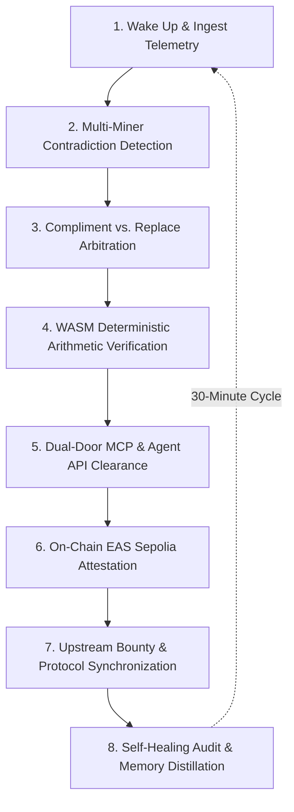

# FinTech Autonomous Sentinel (Harness² Multi-Miner Arbitration & Spend Firewall)

## 1. Architectural Philosophy: The "Compliment vs. Replace" Judo Strategy
Decentralized intelligence networks (such as Telegraph Protocol) rely on distributed "Miners" providing data to autonomous "Minds" and consumer agents. 

However, single-miner dependence is a catastrophic vulnerability:
- **Single-Miner Hallucination**: An individual miner may report phishing sites as safe, miss newly listed sanctions addresses, or hallucinate historical geological figures.
- **Floating-Point & Arithmetic Drift**: Standard LLM JSON outputs and off-chain scripts suffer from floating-point rounding errors and decimal crashes.
- **Network Timeouts (504s)**: Heavy upstream queries time out on complex multi-jurisdiction jobs.

### The Winning Posture: "The General Contractor & Arbiter"
Instead of competing in a zero-sum mud fight with specialized miners, the Sentinel operates as the **coordination, verification, and pre-payment firewall layer**:
1. **Compliment the Competitor**: Where peer miners excel in domain-specific verticals (e.g. Queensland gold workings, ERCOT grid power models, smart settlement contracts), ingest their feeds as candidate intelligence and credit them transparently.
2. **Replace / Arbitrate with Deterministic Infra**: Where competitors fail, hallucinate, or suffer arithmetic drift, intercept before financial execution, flag the contradiction, and substitute deterministic ground truth (WASM math, in-memory OFAC trie, ISO 7064 LEI checksums).
3. **Protocol Merger-Readiness**: Build the clean middleware and evaluator PRs that protocol core maintainers can adopt and merge directly post-hackathon.

---

## 2. The 8-Stage Closed-Loop Sentinel Cycle



### Stage 1: Wake Up & Ingest Telemetry
- Inspect live HTTP endpoints, latency metrics, and testnet RPC nodes.
- Monitor ecosystem communication channels (Discord `#showcase`, `#gold-rush`, `#hackathon`) and GitHub issues.
- Guard against false alarms: verify network health before logging anomalies.

### Stage 2: Multi-Miner Contradiction Detection
- When processing intelligence, query multiple independent sources in parallel.
- Categorize observed discrepancies into standard failure taxonomy:
  - `PHISHING_FALSE_NEGATIVE`: Single miner claiming dangerous URL is safe (e.g., GitHub Issue #226).
  - `SANCTIONS_EVASION_MISSED`: Single miner missing obfuscated crypto addresses (e.g., GitHub Issue #208).
  - `SCOPE_OR_ERA_VARIANCE`: Disagreement arising from conflicting temporal or geographical definitions (e.g., primary ore vs. tailings dump reprocessing).
  - `ARITHMETIC_FLOAT_DRIFT`: Decimals and sub-cent rounding errors in LLM invoice totals (e.g., GitHub Issue #227).

### Stage 3: Compliment vs. Replace Arbitration
- Synthesize conflicting inputs into an immutable arbitration record:
  ```json
  {
    "target": "Mount Morgan Mine",
    "sources_ingested": ["GSQ GeoResGlobe", "Miner 731006", "OathCast Working Map"],
    "discrepancies_caught": 2,
    "root_cause": "Primary ore exhaustion (262t) vs Tailings retreatment (56t)",
    "arbitration_verdict": "SYNTHESIS_ARBITRATED",
    "consensual_alignment_bps": 10000
  }
  ```
- Transparently cite verified peer miners whose data matched ground truth.

### Stage 4: Deterministic WASM & Fixed-Point Verification
- **Never allow floating-point arithmetic on financial amounts**.
- Pass all line-item quantities, unit prices, tax rates, and retention deadbands through a standalone zero-import WebAssembly module (`comparator.wasm`).
- Enforce ISO 7064 Mod 97-10 check on LEIs: `BigInt(digits) % 97n === 1n`.
- Check EVM recipient addresses against the in-memory 19,565-row OFAC SDN trie in <25ms.

### Stage 5: Dual-Door MCP & Agent API Clearance
- Expose all arbitration and firewall tools through dual interfaces:
  1. **Streamable HTTP JSON-RPC 2.0**: Keyless, zero-install endpoint for web agents and Claude/Cursor remote loops (`/api/mcp`).
  2. **Stdio CLI**: Local subprocess transport via `npx` or native binary.
- Ensure response latency remains sub-500ms to avoid blocking agent tool-call loops.

### Stage 6: On-Chain EAS Sepolia Attestation
- For approved or arbitrated decisions requiring auditability, anchor an Ethereum Attestation Service (EAS) record on Sepolia.
- Attestation payload schema:
  - `bytes32 spendHash`: SHA-256 digest of verified counterparty and invoice data.
  - `uint256 amountMicroCents`: Bit-exact integer amount.
  - `bool sanctionsClean`: OFAC trie verification flag.
  - `uint16 consensusBps`: Consensual alignment score (10,000 = 100.00%).

### Stage 7: Upstream Bounty & Protocol Synchronization
- Maintain 100% clean CI passing status on all upstream open PRs.
- Avoid duplicate bounty submissions; focus on deep, testable contributions.
- Distinguish rigorously between testnet testing and production scale.

### Stage 8: Self-Healing Audit & Memory Distillation
- Before concluding any cycle, append significant actions to `audit/AUDIT_LOG.md`.
- Distill newly discovered operational lessons into `memory/EXPERIENCE.md`.
- Leave the working tree 100% clean with SHA-256 plan parity intact.
